# User Authentication & JWT Backend API

A secure, production-ready backend authentication system built with Node.js, Express.js, MongoDB, and JSON Web Tokens (JWT) stored in HTTP-only cookies.

---

## Table of Contents
1. [Project Overview](#project-overview)
2. [Features](#features)
3. [Tech Stack](#tech-stack)
4. [Project Structure](#project-structure)
5. [Authentication Flow](#authentication-flow)
6. [Environment Variables](#environment-variables)
7. [Installation & Local Setup](#installation--local-setup)
8. [Running the Application](#running-the-application)
9. [API Documentation](#api-documentation)
10. [Automated & Manual Testing](#automated--manual-testing)
11. [Postman Collection Guide](#postman-collection-guide)
12. [Deployment to Render](#deployment-to-render)
13. [Security Best Practices](#security-best-practices)

---

## Project Overview

This project provides a robust, backend-focused User Authentication service designed for real-world production environments. It implements industry-standard authentication patterns:
- User registration with validation and duplicate prevention
- Cryptographic password hashing using `bcryptjs`
- Authentication via signed JSON Web Tokens (JWT)
- Cookie-based session storage using secure `HTTP-only` cookies (shielding tokens against Cross-Site Scripting / XSS attacks)
- Route protection middleware to authenticate API requests
- Safe user profile retrieval (ensuring password hashes are never exposed)
- Complete logout functionality that invalidates the client cookie

---

## Features

- **User Registration**: Validates name, email format, and password length (minimum 6 characters), with automatic duplicate detection.
- **Bcrypt Password Hashing**: Passwords are automatically salted and hashed prior to being stored in MongoDB.
- **User Login**: Secure credential verification with generic error messaging to mitigate enumeration attacks.
- **Signed JWT Generation**: Creates tamper-evident tokens containing the user ID and expiration window (1 day).
- **HTTP-Only Cookies**: Stores authentication tokens in HTTP-only cookies with configurable `secure` and `sameSite` flags.
- **JWT Authentication Middleware**: Intercepts requests, validates cookies/tokens, checks user status in MongoDB, and rejects unauthorized access with HTTP 401.
- **Protected User Profile**: Restricts `/api/user/profile` to verified users, returning safe user metadata.
- **Logout Endpoint**: Safely clears the authentication cookie from the client browser.
- **MongoDB & Mongoose**: Fully structured schema with validation, indexes, and custom JSON transforms.
- **Postman Testing Collection**: Included collection for one-click testing of all authentication workflows.
- **Render Deployment Ready**: Production-compatible host and port configurations for seamless cloud deployment.

---

## Tech Stack

| Technology | Purpose |
|------------|---------|
| **Node.js** | Server-side JavaScript runtime |
| **Express.js** | Minimalist web application framework |
| **MongoDB** | NoSQL document database |
| **Mongoose** | Object Data Modeling (ODM) library for MongoDB |
| **bcryptjs** | Password salting and hashing library |
| **jsonwebtoken** | JWT creation, signing, and verification |
| **cookie-parser** | HTTP cookie parsing middleware |
| **dotenv** | Environment variable management |
| **cors** | Cross-Origin Resource Sharing middleware |

---

## Project Structure

```text
jwt-authentication/
│
├── controllers/
│   └── authController.js              # Register, login, and logout handlers
│
├── middleware/
│   └── authMiddleware.js              # Cookie/JWT verification middleware
│
├── models/
│   └── User.js                        # Mongoose schema, bcrypt hook, and methods
│
├── routes/
│   ├── authRoutes.js                  # Public auth routes (/register, /login, /logout)
│   └── userRoutes.js                  # Protected user routes (/profile)
│
├── postman/
│   └── JWT-Authentication.postman_collection.json # Postman test collection
│
├── tests/
│   └── auth.test.js                   # Automated test script for all 10 flows
│
├── .env.example                       # Template for required environment variables
├── .gitignore                         # Excludes node_modules, .env, and logs
├── package.json                       # Dependencies, metadata, and scripts
├── server.js                          # Server bootstrap, MongoDB connection, & Express app
└── README.md                          # Comprehensive documentation
```

---

## Authentication Flow

```mermaid
flowchart TD
    subgraph Registration Flow
        R1[Client submits POST /api/auth/register] --> R2[Validate name, email, password]
        R2 --> R3[Check email uniqueness in MongoDB]
        R3 --> R4[bcryptjs hashes password with 10 salt rounds]
        R4 --> R5[Store user in MongoDB]
        R5 --> R6[Return 201 Created Response]
    end

    subgraph Login Flow
        L1[Client submits POST /api/auth/login] --> L2[Find user by email]
        L2 --> L3[Compare password using bcryptjs.compare]
        L3 -->|Valid| L4[Generate JWT signed with JWT_SECRET]
        L3 -->|Invalid| L5[Return 401 Invalid Credentials]
        L4 --> L6["Set HTTP-only Cookie ('token')"]
        L6 --> L7[Return 200 OK with User Profile]
    end

    subgraph Protected Route Flow
        P1[Client requests GET /api/user/profile] --> P2["authMiddleware checks 'token' cookie"]
        P2 -->|Missing Token| P3[Return 401 Unauthorized]
        P2 -->|Present| P4[Verify token using JWT_SECRET]
        P4 -->|Invalid / Expired| P5[Return 401 Unauthorized]
        P4 -->|Valid| P6[Fetch user from MongoDB without password]
        P6 --> P7[Attach user to req.user and call next]
        P7 --> P8[Return 200 OK with safe user details]
    end

    subgraph Logout Flow
        O1[Client submits POST /api/auth/logout] --> O2["Clear 'token' cookie on client"]
        O2 --> O3[Return 200 OK Logged Out]
        O3 --> O4[Subsequent GET /api/user/profile fails with 401]
    end
```



---

## Environment Variables

Create a `.env` file in the project root directory by copying `.env.example`:

```bash
cp .env.example .env
```

Define the following environment variables:

| Variable | Description | Example |
|----------|-------------|---------|
| `MONGODB_URI` | MongoDB connection string (Local or MongoDB Atlas) | `mongodb+srv://<user>:<password>@cluster.mongodb.net/jwt_auth?retryWrites=true&w=majority` |
| `JWT_SECRET` | Secret key used to sign and verify JWT tokens | `super_secret_jwt_key_12345` |
| `PORT` | Port number on which the server listens (Render sets this dynamically) | `5000` |
| `NODE_ENV` | Runtime environment (`development` or `production`) | `development` |

---

## Installation & Local Setup

### 1. Prerequisites
- **Node.js** (v18.0.0 or later)
- **MongoDB** (Local instance or free [MongoDB Atlas](https://www.mongodb.com/cloud/atlas) cluster)

### 2. Clone and Install
```bash
git clone https://github.com/<your-username>/jwt-authentication.git
cd jwt-authentication
npm install
```

### 3. Configure Environment
Create `.env` and provide your MongoDB connection string and a secure secret:
```env
MONGODB_URI=mongodb://127.0.0.1:27017/jwt_auth
JWT_SECRET=your_super_secret_key_here
PORT=5000
NODE_ENV=development
```

---

## Running the Application

### Development Mode (with hot-reloading)
```bash
npm run dev
```

### Production Mode
```bash
npm start
```

When running, the server will output:
```text
MongoDB Connected: <cluster-host>
Server running in development mode on http://0.0.0.0:5000
```

---

## API Documentation

### Base URL
- **Local:** `http://localhost:5000`
- **Render Production:** `https://your-service-name.onrender.com`

---

### 1. Register User
- **Method:** `POST`
- **URL:** `/api/auth/register`
- **Auth Required:** No
- **Headers:** `Content-Type: application/json`
- **Request Body:**
```json
{
  "name": "Sanjay",
  "email": "sanjay@example.com",
  "password": "Password123"
}
```
- **Responses:**
  - `201 Created`
  ```json
  {
    "success": true,
    "message": "User registered successfully"
  }
  ```
  - `400 Bad Request` (Missing field, invalid email, short password, or duplicate email)
  ```json
  {
    "success": false,
    "message": "Email is already registered"
  }
  ```

---

### 2. Login User
- **Method:** `POST`
- **URL:** `/api/auth/login`
- **Auth Required:** No
- **Headers:** `Content-Type: application/json`
- **Request Body:**
```json
{
  "email": "sanjay@example.com",
  "password": "Password123"
}
```
- **Cookies Set:** `token=<jwt>; HttpOnly; Path=/; Max-Age=86400`
- **Responses:**
  - `200 OK`
  ```json
  {
    "success": true,
    "message": "Login successful",
    "user": {
      "id": "65b9e07f91c7847bca859421",
      "name": "Sanjay",
      "email": "sanjay@example.com"
    }
  }
  ```
  - `401 Unauthorized` (Invalid credentials)
  ```json
  {
    "success": false,
    "message": "Invalid email or password"
  }
  ```

---

### 3. Get Authenticated User Profile
- **Method:** `GET`
- **URL:** `/api/user/profile`
- **Auth Required:** Yes (HTTP-only cookie `token`)
- **Headers:** None required (cookie automatically transmitted by browser/Postman)
- **Responses:**
  - `200 OK`
  ```json
  {
    "success": true,
    "user": {
      "id": "65b9e07f91c7847bca859421",
      "name": "Sanjay",
      "email": "sanjay@example.com"
    }
  }
  ```
  - `401 Unauthorized` (No token, expired token, or invalid token)
  ```json
  {
    "success": false,
    "message": "Access denied. No authentication token provided."
  }
  ```

---

### 4. Logout User
- **Method:** `POST`
- **URL:** `/api/auth/logout`
- **Auth Required:** No
- **Cookies Cleared:** `token` is expired and cleared.
- **Responses:**
  - `200 OK`
  ```json
  {
    "success": true,
    "message": "Logged out successfully"
  }
  ```

---

## Automated & Manual Testing

To run the complete automated test suite verifying all 10 requirements:

```bash
npm test
```

### Verified Test Cases:
1. **Server Initialization**: Validates Express server start and MongoDB connection.
2. **User Registration**: Successfully creates user with valid inputs (HTTP 201).
3. **Duplicate Prevention**: Rejects registration with existing email (HTTP 400).
4. **Valid Login**: Authenticates user and issues HTTP-only `token` cookie (HTTP 200).
5. **Invalid Login**: Rejects invalid credentials with generic error message (HTTP 401).
6. **Protected Profile Access**: Grants profile access when valid auth cookie is present (HTTP 200).
7. **Unauthenticated Access**: Rejects access to `/api/user/profile` without token (HTTP 401).
8. **Logout**: Clears authentication cookie (HTTP 200).
9. **Post-Logout Invalidation**: Confirms profile access is blocked after logout (HTTP 401).
10. **Bcrypt Hash Verification**: Directly queries MongoDB document to guarantee password is a cryptographic bcrypt hash (starts with `$2a$` or `$2b$`) and never plain text.

---

## Postman Collection Guide

A pre-configured Postman Collection is located at:
`postman/JWT-Authentication.postman_collection.json`

### How to Import and Test:
1. Open **Postman**.
2. Click **Import** (top left).
3. Drag and drop `postman/JWT-Authentication.postman_collection.json` (or click "files" and select it).
4. Select the imported collection **JWT-Authentication**.
5. Check collection variables: `baseUrl` defaults to `http://localhost:5000` (update to your Render URL for testing live deployment).
6. Run the requests sequentially:
   - **1. Register**
   - **2. Login** (Postman automatically stores the `Set-Cookie` header in its cookie jar)
   - **3. Get Profile** (Cookie is automatically sent; tests verify HTTP 200 and profile payload)
   - **4. Logout** (Cookie is cleared)
   - **5. Get Profile After Logout** (Tests verify HTTP 401 Unauthorized)
7. Alternatively, click **Run collection** to run all 5 requests automatically and view 100% passing test assertions.

---

## Deployment to Render

This project is configured out-of-the-box for [Render](https://render.com).

### Step-by-Step Instructions:

1. **Push your code to GitHub**:
   ```bash
   git init
   git add .
   git commit -m "feat: complete JWT authentication backend"
   git branch -M main
   git remote add origin https://github.com/<your-username>/jwt-authentication.git
   git push -u origin main
   ```

2. **Create a MongoDB Atlas Cluster (Free)**:
   - Go to [MongoDB Atlas](https://www.mongodb.com/cloud/atlas) and create a free Shared Cluster (M0).
   - In **Network Access**, add IP `0.0.0.0/0` (allow access from anywhere).
   - In **Database Access**, create a database user with username and password.
   - Click **Connect** → **Drivers** (Node.js) and copy the connection string.

3. **Deploy Web Service on Render**:
   - Log in to [Render Dashboard](https://dashboard.render.com).
   - Click **New +** → **Web Service**.
   - Connect your GitHub repository: `jwt-authentication`.
   - Configure settings:
     - **Name:** `jwt-authentication-api` (or preferred name)
     - **Region:** Closest to your database (e.g., Oregon or Frankfurt)
     - **Branch:** `main`
     - **Runtime:** `Node`
     - **Build Command:** `npm install`
     - **Start Command:** `npm start`
     - **Plan:** Free

4. **Add Environment Variables in Render**:
   Under **Environment Variables**, add:
   - `MONGODB_URI`: `mongodb+srv://<username>:<password>@cluster0.example.mongodb.net/jwt_auth?retryWrites=true&w=majority`
   - `JWT_SECRET`: `your_random_secure_jwt_secret_key`
   - `NODE_ENV`: `production`
   - *(Note: Render sets `PORT` automatically)*

5. **Deploy & Verify**:
   - Click **Deploy Web Service**.
   - Once deployed, visit your live URL: `https://your-service.onrender.com/`
   - Test endpoints using your Postman collection by setting `baseUrl` to your Render URL.

---

## Security Best Practices

1. **Passwords Never Stored in Plain Text**: Every password is processed using `bcryptjs` with 10 salt rounds before persistence.
2. **Never Returning Passwords**: Passwords and `__v` fields are automatically deleted via Mongoose `toJSON` transforms and query projections (`.select('-password')`).
3. **HTTP-Only Cookies**: Protected against cross-site scripting (XSS) by preventing JavaScript from accessing `document.cookie`.
4. **Environment Isolation**: Production runs with `secure: true` (HTTPS) and `sameSite: 'none'` (cross-domain cookies), while local development runs with `lax`.
5. **No Blind Trust in Frontend Data**: User identity is derived strictly from the cryptographically verified JWT payload, not from client-supplied IDs in request bodies.
6. **Generic Error Responses**: Login failures return an ambiguous "Invalid email or password" to protect against account enumeration attacks.
